  

O **Drifty Client** é um projeto de client para Minecraft, desenvolvido com foco em **performance**, **personalização** e **estabilidade**, especialmente para jogadores que buscam uma experiência PvP fluida, moderna e competitiva.

Nossa proposta é unir **leveza, simplicidade e desempenho** em uma experiência visual limpa, sem elementos desnecessários.

Os principais objetivos do nosso desenvolvimento são:

- **Alta performance** — Otimizações para alcançar o melhor desempenho possível
- **Leve e estável** — Experiência fluida com baixo consumo de recursos
- **Interface minimalista** — Design moderno, limpo e intuitivo
- **Personalização** — Recursos para adaptar o client às preferências do jogador
- **Experiência PvP** — Funcionalidades pensadas para jogadores competitivos
- **Evolução contínua** — Melhorias, correções e novos recursos durante o desenvolvimento

| Projeto | Descrição | Status |
|---------|-----------|--------|
| **Drifty Client** | Client de Minecraft com foco em PvP e performance | Em desenvolvimento |

Tecnologias do ecossistema de desenvolvimento Minecraft:

O **Drifty Client** é construído com dedicação, criatividade e o objetivo de oferecer uma experiência de Minecraft cada vez melhor.

Agradecemos a todos que contribuem com ideias, desenvolvimento, testes e sugestões para o crescimento do projeto.

Áreas de foco do desenvolvimento:

- **Otimização de renderização** para melhorar a fluidez durante o jogo
- **Interface personalizável** com elementos visuais minimalistas
- **Sistema modular** para organizar recursos e funcionalidades
- **Gerenciamento eficiente de recursos** para reduzir consumo desnecessário
- **Estabilidade** para proporcionar uma experiência consistente

---

**Drifty Client**

*Lightweight. Smooth. Drifty.*

